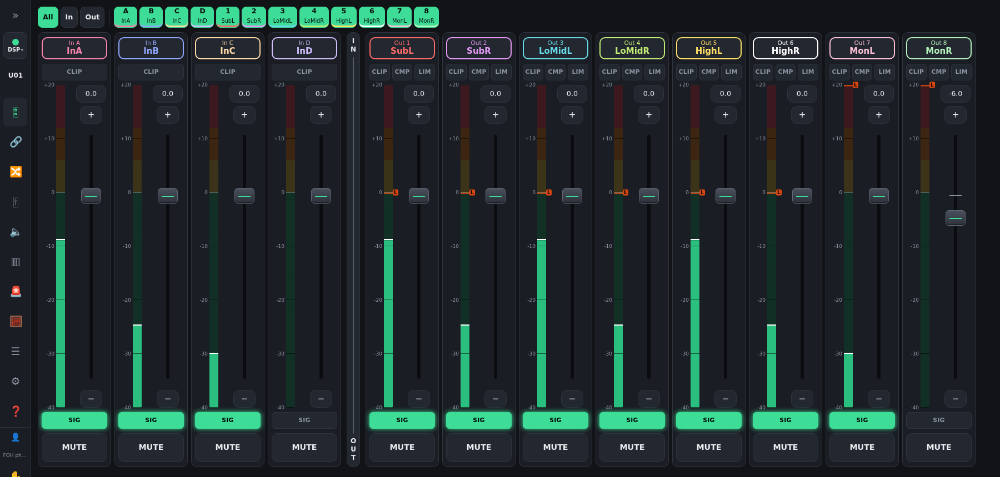
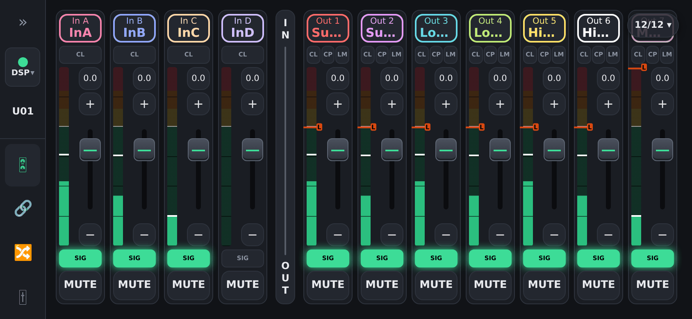
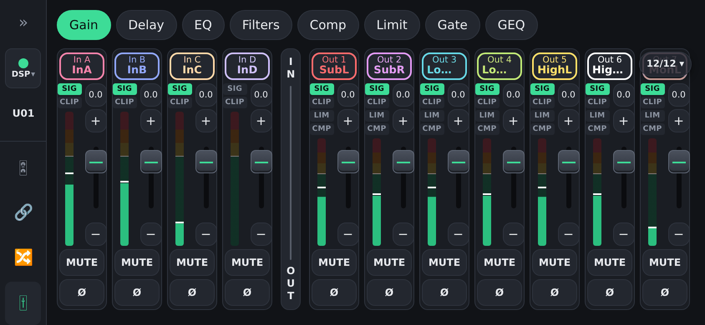
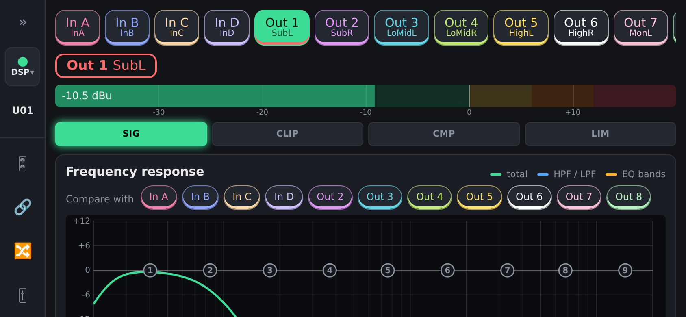
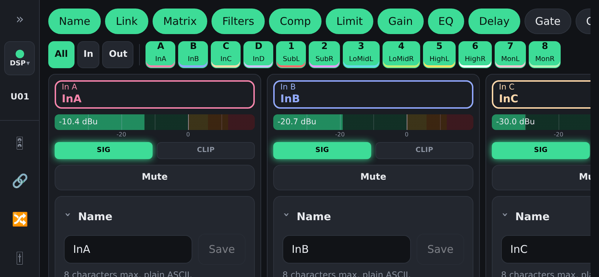
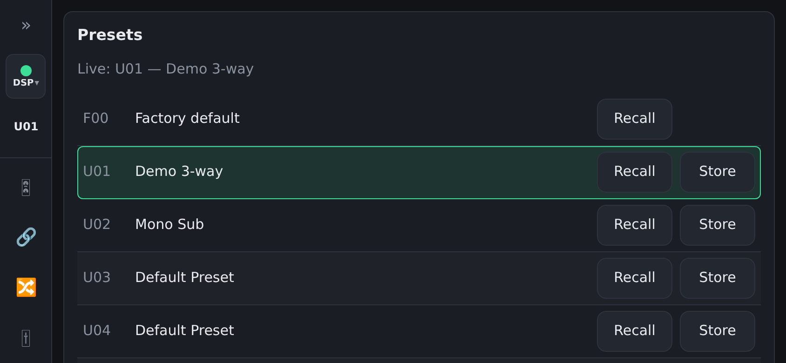
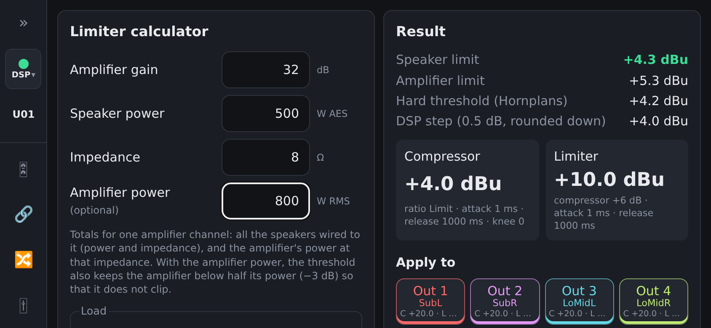

# tracks-dsp-controller

Self-hosted web app to control a **t.racks DSP 408, 206 or 204** over the network from several
browsers at once (computers, tablets, phones), with live metering. The model is detected
automatically.

One backend process owns the TCP connection to the DSP. It serves a web UI, which also works on
phones, to every client on the local network and keeps them in sync in real time. It works fully
offline.

> [!WARNING]
> **Unofficial software.** This project is not affiliated with, endorsed by or supported by
> Thomann, t.racks or Musicrown. The DSP protocol was reverse-engineered; the official editor
> remains the reference.
>
> **Vibe-coded.** Most of the code and documentation was written by an AI coding assistant
> (Claude Code), directed, reviewed and tested by a human on a real DSP 408. It is tested
> (unit, end-to-end and against hardware), but it has not been audited line by line.
>
> A DSP drives amplifiers and speakers: a wrong value can be loud or damage equipment. Try it
> on the simulator or on a spare preset first, keep backups of your presets, and use it at your
> own risk. The software comes with **no warranty** ([AGPL-3.0](LICENSE), sections 15–16).

Try it without a DSP: `uv run tracks-dsp-controller --dsp demo`, then open http://localhost:8080
(code `0000`).

## Screenshots

Taken with a simulated DSP 408 (`--dsp demo`).



On a phone, in landscape:

| Live | Params (gain strips) |
| :---: | :---: |
|  |  |
| **Channel page** | **All-in-one** |
|  |  |
| **Presets** | **Limiter calculator** |
|  |  |

## Features

- **Every DSP parameter**: gain, mute, phase, 4 → 8 routing matrix, PEQ (8 bands on inputs, 9 on
  outputs), high/low-pass filters, delay (in ms or metres), compressor and limiter on outputs,
  noise gate and 31-band GEQ on inputs, channel names.
- **Channel links**: linked channels follow each other, as on the DSP. Optionally (Settings ›
  *Merge linked channels*), a link group shows as one channel ("Out 1+5") in every view except
  the Matrix and Link tabs.
- **Channel colours**: one colour per channel, the same in every view; a link group takes the
  colour of its lowest-numbered channel.
- **Frequency response graph**: on each channel page (filters, PEQ, GEQ), with other channels'
  curves as overlays. Drag a PEQ band's marker for its frequency and gain, turn the mouse wheel
  over it for its Q.
- **Limiter calculator**: compressor and limiter thresholds from the amplifier gain and the
  speaker's power, impedance and load.
- **Presets**: recall, store and rename U01–U20, with an "unsaved changes" indicator.
- **Preset files**: export the live setup as a `.prs` file of the official t.racks editor, or
  import one (and store it in a slot); the outputs are muted while a file loads.
- **Live meters**: level, peak, clip, limiter and compressor indicators on every channel, 1 to
  10 Hz (5 by default).
- **Several DSPs**: one server controls one DSP or several (one `--dsp` each, models mixed, e.g. a
  main system and a delay line); the DSP picker shows each one's status and preset and switches
  the browser tab to another.
- **Several people at once**: every browser sees every change, the last writer wins. A client can
  *take control*: the others are read-only while it is active (released after 120 s idle).
- **Master**: one client can disconnect another one and block new connections; the block ends
  with the role (released, logged out, or the app closed for 5 minutes).
- **Lock screen**: this browser becomes read-only on its current view until the access code is
  typed, for a computer or phone left unattended; a reload stays locked.
- **Clean shutdown**: *Disconnect from DSP and shutdown* (Settings) frees the DSPs (each accepts
  one program at a time, e.g. before opening the t.racks editor) and stops the server; with
  Docker Compose the container then stays stopped.
- **Unstable networks**: a dead link is detected within ~12 s, browsers and the server reconnect
  by themselves, and the command timeout adapts to the DSP's round trip (a Wi-Fi bridge or a VPN
  is fine). A banner says which link is down, and the controls are disabled meanwhile, so no
  change is silently lost.
- **Access code and HTTPS**: a shared code (`--pin`, default `0000`), and optionally a view code
  (`--view-pin`) for read-only access: everything is shown, nothing can be changed (a guest, a
  phone left at front of house); optional HTTPS with your certificate or a self-signed one, on the
  same port.
- **Offline**: no database, no internet access, no external assets.
- **Simulator**: `tracks-dsp-controller sim` runs a simulated DSP 408, 206 or 204 on the network,
  to test without a device (presets kept across restarts, fault injection, live console).

## Compatibility

✅ supported and tested · 🟡 should work, not tested by this project · ❌ not supported

| DSP | |
|---|---|
| t.racks DSP 408, firmware V0104P | ✅ every parameter the app edits was verified on this device |
| t.racks DSP 408, other firmware | 🟡 |
| t.racks DSP 206, DSP 204 (V0104P) | 🟡 same commands as the 408, checked against captures of a real 206 and notes from a real 204 ([PROTOCOL.md §10](docs/PROTOCOL.md)) |
| Other t.racks / Musicrown models (DSP 4x4 Mini…) | ❌ other channel counts and config layouts |

The model is detected automatically. The DSP is reached over Ethernet (TCP port 9761, no USB)
and accepts one program at a time: the app **or** the official editor. Reports on untested
devices are welcome.

| Server | |
|---|---|
| Linux x86-64 | ✅ executable, Docker image or `uv run` |
| Linux arm64, e.g. Raspberry Pi 3 / 4 / 5 with a 64-bit OS | 🟡 executable, Docker image or `uv run` |
| Windows 10 / 11 x64 | 🟡 executable (built in CI) |
| macOS | 🟡 `uv run` or Docker (no executable) |

The Linux executables need glibc ≥ 2.36 (Debian 12, Ubuntu 24.04, Raspberry Pi OS bookworm and
later). From source: Python ≥ 3.12 with [uv](https://docs.astral.sh/uv/); Node is not needed.
Browsers: current Safari (iOS), Chrome (Android), Firefox and Chrome (desktop), from 360 px wide.

## Usage

Pick one way to run the server, then open `http://<server-ip>:8080` from any device on the LAN
and enter the access code (`--pin`, default `0000`: change it).

### Standalone executable (nothing to install)

Download the file for your system from the
[latest release](https://github.com/tom-da-costa/tracks-dsp-controller/releases/latest)
(linux-amd64, linux-arm64 for a Raspberry Pi 64-bit, windows-amd64), then run it with the DSP's
address. With the command line, for example for version v0.9.0:

```bash
# Linux (linux-arm64 on a Raspberry Pi)
VERSION=v0.9.0
curl -LO https://github.com/tom-da-costa/tracks-dsp-controller/releases/download/$VERSION/tracks-dsp-controller-$VERSION-linux-amd64
chmod +x tracks-dsp-controller-$VERSION-linux-amd64
./tracks-dsp-controller-$VERSION-linux-amd64 --dsp 192.168.1.50 --pin 1234

# Demo without a DSP (a simulated DSP runs inside the app)
./tracks-dsp-controller-$VERSION-linux-amd64 --dsp demo
```

```powershell
# Windows (PowerShell); Windows may ask to allow it on the network the first time
$VERSION = "v0.9.0"
Invoke-WebRequest -OutFile tracks-dsp-controller-$VERSION-windows-amd64.exe `
  https://github.com/tom-da-costa/tracks-dsp-controller/releases/download/$VERSION/tracks-dsp-controller-$VERSION-windows-amd64.exe
.\tracks-dsp-controller-$VERSION-windows-amd64.exe --dsp 192.168.1.50 --pin 1234
```

The latest build of `main` is always available as the
[**main** pre-release](https://github.com/tom-da-costa/tracks-dsp-controller/releases/tag/main-latest),
with fixed file names (`tracks-dsp-controller-main-linux-amd64` …), rebuilt on every push.

### From a clone, with uv

[uv](https://docs.astral.sh/uv/) installs the right Python by itself; Node is not needed. Install
it with one command:

```bash
# Linux, macOS
curl -LsSf https://astral.sh/uv/install.sh | sh
# Windows (PowerShell)
powershell -ExecutionPolicy ByPass -c "irm https://astral.sh/uv/install.ps1 | iex"
```

Then:

```bash
git clone https://github.com/tom-da-costa/tracks-dsp-controller.git && cd tracks-dsp-controller
uv run tracks-dsp-controller --dsp 192.168.1.50 --pin 1234
uv run tracks-dsp-controller --dsp demo   # demo without a DSP
```

Each DSP is a `--dsp [NAME=][MODEL@]HOST[:PORT][/ID]`, repeated for several. The name is the
DSP's label in the app (default `dsp`, then `dsp2`…); the model, port and front-panel ID are
optional (default: `--model`, i.e. detected; 9761; `--device-id`, i.e. searched for). `demo` in
place of the address runs a simulated DSP inside the app.

```bash
uv run tracks-dsp-controller --dsp main=192.168.1.50 --dsp delay=192.168.1.51 --pin 1234
uv run tracks-dsp-controller --dsp main=demo --dsp delay=206@demo   # demo: a 408 and a 206
```

### Docker

```bash
docker run -d -p 8080:8080 -e TDSP_PIN=1234 ghcr.io/tom-da-costa/tracks-dsp-controller --dsp 192.168.1.50

# Or Docker Compose
cp .env.example .env   # set TDSP_DSP, TDSP_PIN …
docker compose up -d
```

### Command-line options

`tracks-dsp-controller [options]` runs the web app (the `serve` command, the default). Most
options can also be set with an environment variable (used by Docker and `.env`); a command-line
option wins over its variable. The old `DSP408_*` names (read with a warning in 0.8) are no
longer read: rename them to `TDSP_*`. `--dsp` replaced `--dsp-host` / `TDSP_HOST`, `--dsp-port`
/ `TDSP_PORT` and `--demo` / `TDSP_DEMO` (`--dsp HOST:PORT`, `--dsp demo`), in the other
commands too.

| Option | Variable | Default | What it does |
|---|---|---|---|
| `--dsp [NAME=][MODEL@]HOST[:PORT][/ID]` | `TDSP_DSP` | | A DSP to control (required); repeat it for several (in the variable, separate them with spaces). `HOST` is its address, or `demo` for a DSP simulated inside the app; port 9761 by default |
| `--model auto\|408\|206\|204` | `TDSP_MODEL` | `auto` | Default model of every `--dsp`: `auto` detects it; a number enforces it (refused if the device differs) |
| `--device-id N` | `TDSP_DEVICE_ID` | searched for | Default ID number (set on the DSP's front panel, 1-250) of every `--dsp`; setting it skips the search |
| `--pin CODE` | `TDSP_PIN` | `0000` | Access code asked by the web UI |
| `--view-pin CODE` | `TDSP_VIEW_PIN` | none | A second code, for read-only access: the server refuses every change from those sessions (writes, presets, control, settings) |
| `--host IP` | `TDSP_LISTEN_HOST` | `0.0.0.0` | Address the web server listens on |
| `--port N` | `TDSP_LISTEN_PORT` | `8080` | Port of the web UI |
| `--meter-rate HZ` | `TDSP_METER_RATE` | `5` | Meter refresh rate, 1-10 Hz (also in the app's Settings, per DSP) |
| `--lock-idle-timeout S` | `TDSP_LOCK_IDLE_TIMEOUT` | `120` | Seconds of inactivity before the control lock is released |
| `--resync-interval S` | `TDSP_RESYNC_INTERVAL` | `0` (off) | Re-read the whole DSP config every S seconds |
| `--command-timeout S` | `TDSP_COMMAND_TIMEOUT` | `0.5` | Floor of the adaptive command timeout; it grows on a slow link |
| `--experimental` | `TDSP_EXPERIMENTAL` | off | Allow parameters not yet verified on a real DSP 408 (always allowed on a `demo` DSP) |
| `--demo-scenario NAME` | `TDSP_DEMO_SCENARIO` | `demo` | Presets and signals of the `demo` DSPs: `demo`, `silent`, `clipping`, `stress` |
| `--tls-cert FILE`, `--tls-key FILE` | `TDSP_TLS_CERT`, `TDSP_TLS_KEY` | | HTTPS with your certificate and key (PEM) |
| `--tls-self-signed` | `TDSP_TLS_SELF_SIGNED` | off | HTTPS with a generated self-signed certificate |
| `--tls-names NAMES` | `TDSP_TLS_NAMES` | | Extra names or addresses for that certificate, comma-separated |
| `--tls-dir DIR` | `TDSP_TLS_DIR` | the user's data directory | Where the self-signed certificate is kept |
| `--log-level LEVEL` | `TDSP_LOG_LEVEL` | `info` | `debug`, `info`, `warning` or `error` |
| `--profile FILE` | `TDSP_PROFILE` | | Protocol profile (TOML) overriding the model's built-in one |
| `--version` | | | Print the version |

Other commands, for diagnostics (`tracks-dsp-controller <command> --help` for their options):

| Command | What it does |
|---|---|
| `probe --dsp IP ACTION` | Query a DSP without the web app: identity, meters, config dump, preset file export ([docs/PROBE.md](docs/PROBE.md)) |
| `proxy --dsp IP --listen HOST:PORT --log FILE` | Sit between the official editor and the DSP and log every frame ([docs/captures.md](docs/captures.md)) |

## Using the app

- **Live** view (first tab): per channel, CLIP / CMP / LIM indicators, a meter graduated every
  10 dB with the compressor (C) and limiter (L) thresholds, the gain fader with − / +, SIG
  (signal above a threshold set in Settings, −60 dBu by default) and MUTE. The meters' range
  (−40 to +20 dBu by default) and LED-style segments (continuous by default) are set in
  Settings.
- **Link** and **Matrix** tabs: channel links (with each channel's name) and the routing grid,
  for the whole system at once.
- **Params** view: one setting on the channels you pick. Gain, delay, filters, compressor,
  limiter and gate are shown as one strip per channel, with vertical faders; EQ as one frequency
  response graph per channel, on which the bands are edited.
- **All-in-one** view: one column per channel with the settings you pick, in the order a system
  is set up (name, link, routing, filters, compressor, limiter, gain, EQ, delay, then the
  inputs' gate and GEQ), with MUTE under each meter.
- In Live, Params and All-in-one, a row picks the channels shown (all, inputs, outputs or any
  set); each view remembers its choice in the browser (Params: one choice for every setting).
- **Too loud** view: one indicator that fills the screen, for whoever sets the volume. It lights
  in the compressor's colour when at least one output's compressor or limiter acts (and names
  those outputs), and stays grey otherwise; its brightness is adjustable (per browser). Flashing
  now and then is fine; if it stays lit, turn the volume down.
- **Help** view (English, French, German, Russian or Chinese): how to use the app (tabs, buttons, control, screen lock, presets, settings,
  channel choice) and what each audio setting does (gain, delay, filters, EQ, dynamics, routing,
  links).
- **Full screen:** the ⛶ button at the bottom of the tab bar (Android, desktop browsers).
- **Install on the home screen:** iPhone: Safari › Share › *Add to Home Screen*; it then opens
  full screen without the browser bars. Android: Chrome installs web apps only over HTTPS (or
  on localhost); over plain `http://` on the LAN, use the full-screen button, or put the app
  behind an HTTPS reverse proxy with a valid certificate to get *Install app*.

## Testing without a DSP

`tracks-dsp-controller --dsp demo` runs a simulated DSP inside the app. To test the whole network
path, `tracks-dsp-controller sim` runs, as a second process, a simulated DSP on TCP port 9761,
with fault injection and a console: see [docs/SIMULATOR.md](docs/SIMULATOR.md).

## Documentation

| Document | Content |
|---|---|
| [docs/SIMULATOR.md](docs/SIMULATOR.md) | The simulated DSP (`tracks-dsp-controller sim`): options, console, fidelity |
| [docs/PROBE.md](docs/PROBE.md) | `tracks-dsp-controller probe`: query a DSP from the command line |
| [CONTRIBUTING.md](CONTRIBUTING.md) | Development setup, checks, code rules, device safety |
| [docs/ARCHITECTURE.md](docs/ARCHITECTURE.md) | Components, state model, command pipeline, simulator, client/server API, security |
| [docs/PROTOCOL.md](docs/PROTOCOL.md) | The DSP 408 network protocol, with a confidence level for each item and the open questions |
| [docs/captures.md](docs/captures.md) | How to capture protocol traffic (editor, proxy, probe) |
| [docs/release.md](docs/release.md) | Distribution and releases |

## Tech stack

Python ≥ 3.12 with uv, FastAPI and asyncio for the backend; Svelte 5, TypeScript and Vite for the
UI, built and embedded in the Python package; pytest, ruff and mypy for quality checks; CI on
GitHub Actions.

## Sources and credits

The protocol knowledge builds on the reverse-engineering work of these projects (GPL-3.0, and MIT
for BetterDSPControl). [docs/PROTOCOL.md §0](docs/PROTOCOL.md) says how much each one is trusted.

| Project | Device | Transport | Used for |
|---|---|---|---|
| [Aeternitaas/dsp-408-ui](https://github.com/Aeternitaas/dsp-408-ui) | DSP 408 | TCP 9761 | The only prior source tested on a DSP 408 (Flutter app): framing, gain, mute, matrix, GEQ, presets, meter poll |
| [juli303/t-dsp-ui](https://github.com/juli303/t-dsp-ui) | DSP 408 | TCP 9761 | Identical fork of dsp-408-ui |
| [FlexiFlizz/t.racks-DSP-control](https://github.com/FlexiFlizz/t.racks-DSP-control) | DSP 206 | TCP + USB HID | Python driver: delay, phase, dynamics, slopes; its Wireshark captures of a real 206 define the simulated 206 |
| [Givou/BetterDSPControl](https://git.thiemoo.at/Givou/BetterDSPControl) (MIT) | DSP 204, DSP 408 | TCP + USB HID | A control app tested on a real DSP 204: its protocol notes define the simulated 204 |
| [IMBArator/miniDSP-Linux](https://github.com/IMBArator/miniDSP-Linux) | DSP 4x4 Mini | USB HID | The most rigorous documentation of the protocol family: framing, ACKs, presets, link, meter tail |

The **Limiter calc** tab (`web/src/lib/limiter.ts`) implements the method of **Marc.O**'s
"Intelligent limiter threshold" calculator ([hornplans.free.fr/limiteur.html](http://hornplans.free.fr/limiteur.html)),
dBu mode: formulas and constants (open load AES / 1.5625, closed AES / 2.34375, amplifier at
half power, 0.775 V = 0 dBu). It is re-implemented from the published formulas; no code was
copied.

GPL-3.0 code may be combined with this AGPL-3.0 project (GPLv3 §13 / AGPLv3 §13); MIT material keeps
its copyright notice.

## License

[GNU AGPL-3.0](LICENSE). t.racks is a brand of Thomann; the names are used only to describe
compatibility.
